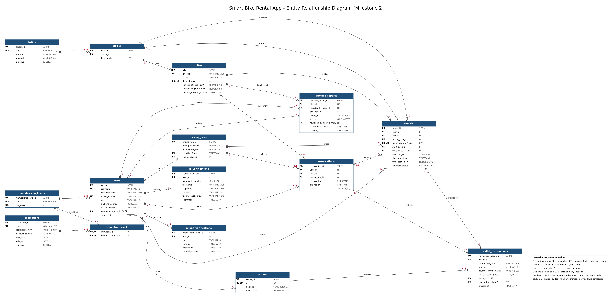

# Smart Bike Rental App - G-Bikes

Software Engineering - GIU Cairo - Milestone 2

## Team
| Name | ID | Role in team |
|------|----|--------------|
| George Atef | 20003898 | Team leader |
| Abdelrahman Hossam | 19009135 | Member |
| Habiba Ahmed Gharabawy | 19005360 | Member |
| Sara Sameh Nosir | 19002226 | Member |
| Anthony Fady Safwat | 19007401 | Member |
| Patrick Hatem Halim | 19006916 | Member |
| Norelden Mahmoud Mohamed | 19008129 | Member |

## ERD
Editable diagram: [erd.drawio](docs/erd.drawio)



Notation: crow's-foot, with the cardinality also written at both ends of every relationship. The legend is inside the diagram.

## Traceability: entities to user stories
| Entity | Justified by user stories |
|--------|---------------------------|
| users | US-01, US-03, US-04, US-13, US-26 |
| phone_verifications | US-02 |
| id_verifications | US-05, US-06 |
| wallets | US-10, US-11, US-12 |
| wallet_transactions | US-10, US-11, US-12, US-16, US-18, US-22 |
| stations | US-07, US-15, US-25 |
| docks | US-07, US-14, US-15, US-25 |
| bikes | US-08, US-09, US-21, US-24, US-25 |
| pricing_rules | US-11, US-16, US-23, US-27 |
| rentals | US-08, US-11, US-13, US-14, US-22 |
| reservations | US-16, US-17, US-18 |
| membership_levels | US-19, US-27 |
| promotions | US-20, US-27 |
| promotion_levels | US-20, US-27 |
| damage_reports | US-21, US-24 |

All 27 stories of the final Milestone 1 backlog are covered by at least one entity.

## Design notes
- **Roles.** Rider, Admin and Company are all rows of `users`, separated by the `role` column. The Milestone 1 backlog has no Company stories (the client gave no Company requirements), so Company is modelled as a role only. This is an assumption, to be confirmed with the client.
- **Station capacity and available bikes** (US-07) are not stored. Capacity is the number of `docks` of a station; available bikes are the `bikes` docked there with status `available`. Storing them would duplicate data.
- **Rental duration** (US-22) is not stored: it is `docked_at - unlocked_at`.
- **Pricing history.** Each price change by the Admin is a new row in `pricing_rules`. A rental or reservation points to the rule it was charged under, so changing the price never changes old bills (US-23).
- **Retrying the ID check** (US-06) adds a new row to `id_verifications`; a rider is verified when one of their rows has status `passed`.
- **Unpaid rides** (US-13) are `rentals` with `payment_status = 'unpaid'`.
- **Many-to-many.** Promotions and membership levels are linked through the junction table `promotion_levels`.
- **Normalization.** The schema is in 3NF, with two deliberate stored values: `wallets.balance` and `rentals.total_cost`. Both are the billed amounts the rider sees and must not change if a price changes later.
- **Placeholder amounts.** The price per minute, reservation fee, membership thresholds and discounts in the seed data are test values only; the client has not decided them yet.

## Database
- DBMS: PostgreSQL <version>
- Database name: smart_bike_rental
- Scripts are in the `schema/` folder; run them in numeric order.

| Script | Contents |
|--------|----------|
| `schema/01_create_tables.sql` | 15 tables with primary keys, foreign keys (each with a justified `ON DELETE` rule), `NOT NULL`, `UNIQUE`, `DEFAULT` and `CHECK` |
| `schema/02_constraints_indexes.sql` | Partial unique indexes (one active rental and one active reservation per bike) and lookup indexes |
| `schema/03_seed_data.sql` | Sample rows for every table |

### How to run
1. In pgAdmin 4, create an empty database named `smart_bike_rental`.
2. Open the Query Tool on it and run `01`, then `02`, then `03`.
3. Check the data with `SELECT * FROM <table>;`.

### Constraint tests
Each of these statements must be rejected after the seed data is loaded:

```sql
-- duplicate username (UNIQUE)
INSERT INTO users (username, password_hash, phone_number) VALUES ('rider_ali', 'x', '+201999999999');
-- rider that does not exist (FOREIGN KEY)
INSERT INTO rentals (user_id, bike_id, pricing_rule_id, start_dock_id) VALUES (999, 1, 2, 1);
-- invalid status (CHECK)
INSERT INTO bikes (qr_code, status) VALUES ('GIU-BIKE-9999', 'flying');
-- second ride on a bike that is already in use (partial UNIQUE index)
INSERT INTO rentals (user_id, bike_id, pricing_rule_id, start_dock_id) VALUES (3, 5, 2, 1);
-- top-up by anything other than Visa (CHECK)
INSERT INTO wallet_transactions (wallet_id, transaction_type, amount, payment_method, card_last_four) VALUES (1, 'top_up', 10, 'cash', '1234');
-- negative wallet balance (CHECK)
UPDATE wallets SET balance = -1 WHERE wallet_id = 1;
-- two bikes in the same dock (UNIQUE)
INSERT INTO bikes (qr_code, dock_id) VALUES ('GIU-BIKE-9998', 1);
-- deleting a rider who has a wallet (ON DELETE RESTRICT)
DELETE FROM users WHERE user_id = 3;
```
